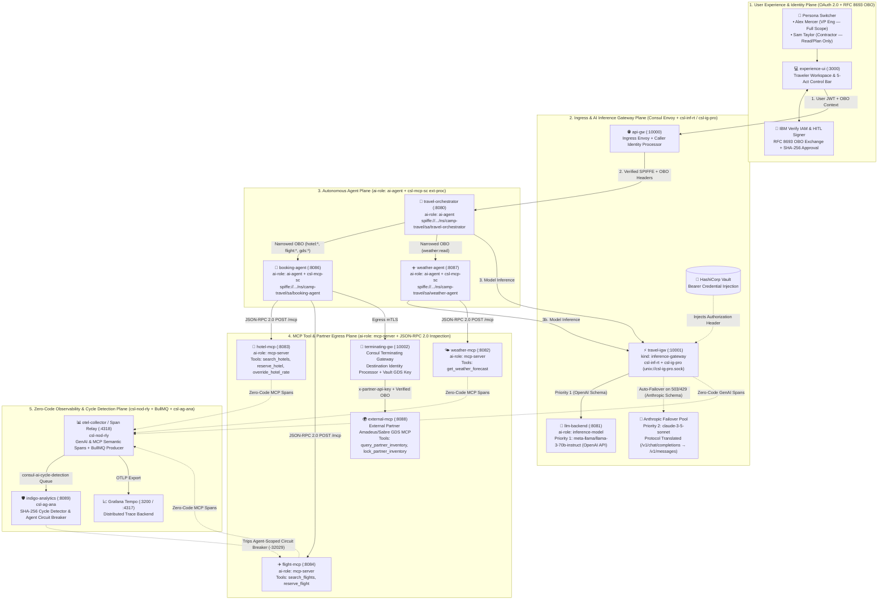
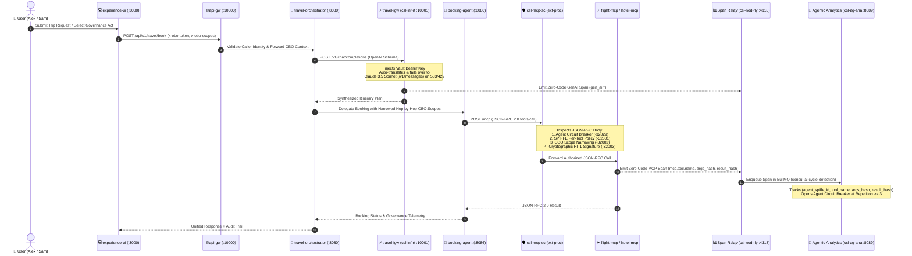

# Consul Enterprise 2.1 Agentic Runtime Fabric — Reference Architecture & Interactive Governance Showcase

[](https://developer.hashicorp.com/consul/docs/agentic-mesh)
[](https://developer.hashicorp.com/consul/docs/release-notes/consul/v2-1-x)
[](https://modelcontextprotocol.io)
[](https://datatracker.ietf.org/doc/html/rfc8693)
[](https://developer.hashicorp.com/consul/docs/agentic-mesh/auto-instrumentation)
[](#%EF%B8%8F-automated-verification-suite-286-tests)

An enterprise reference architecture and **5-Act Interactive Governance Showcase** demonstrating **HashiCorp Consul Enterprise 2.1 Agentic Runtime Fabric** across Kubernetes, Red Hat OpenShift, Docker Compose, and standalone CLI environments.

---

## 📖 Table of Contents

- [Executive Overview](#-executive-overview)
- [Reference Architecture](#-reference-architecture)
  - [5-Plane Topology Diagram](#1-5-plane-topology-diagram)
  - [End-to-End Request & Governance Sequence](#2-end-to-end-request--governance-sequence)
  - [14-Service Component & Workload Catalog](#3-14-service-component--workload-catalog)
  - [Consul 2.1 Agentic Runtime Fabric Primitives](#4-consul-21-agentic-runtime-fabric-primitives)
- [5-Act Interactive Governance Showcase](#-5-act-interactive-governance-showcase)
- [Quickstart & Deployment Guides](#-quickstart--deployment-guides)
  - [Option A: Instant Standalone CLI Showcase (Zero Containers)](#option-a-instant-standalone-cli-showcase-zero-containers)
  - [Option B: Local 14-Service Stack via Docker Compose](#option-b-local-14-service-stack-via-docker-compose)
  - [Option C: Kubernetes & Red Hat OpenShift via Helm](#option-c-kubernetes--red-hat-openshift-via-helm)
- [Consul 2.1 Configuration Reference](#-consul-21-configuration-reference)
- [Automated Verification Suite (286 Tests)](#%EF%B8%8F-automated-verification-suite-286-tests)
- [Repository Structure](#-repository-structure)

---

## 🎯 Executive Overview

Enterprise AI adoption introduces failure modes and security boundaries that traditional L4/L7 service meshes cannot govern alone:

1. **Multi-Provider LLM Outages & API Drift**: Agents hardcoding model endpoints or API schemas break when a primary foundation model throttles (`429`) or fails (`503`).
2. **Over-Privileged MCP Tool Access**: Discovering a tool via Model Context Protocol (`tools/list`) does not mean an autonomous agent should be allowed to invoke every method (`tools/call`)—especially state-mutating or administrative tools.
3. **Confused Deputy & Privilege Escalation**: Agents acting on behalf of human users often forward coarse bearer tokens across multi-agent hops without narrowing scopes per downstream hop.
4. **High-Stakes Autonomous Actions Without Human Approval**: Financial reservations or external partner mutations require cryptographic **Human-in-the-Loop (HITL)** verification at the proxy boundary before execution.
5. **Runaway Agent Loops & Token Burn**: Hallucinating or misconfigured agents can enter infinite retry cycles with identical tool arguments and unchanged responses, exhausting token budgets and downstream APIs.

**Consul Enterprise 2.1 (`consul-ai=enabled`)** solves these challenges in the infrastructure plane—**with zero application code changes**—by elevating **AI Agents (`ai-agent`)**, **MCP Servers (`mcp-server`)**, **Foundation Models (`inference-model`)**, and the **AI Inference Gateway (`inference-gateway`)** into first-class mesh workloads governed by Envoy `builtin/ext-proc` Unix domain socket processors and asynchronous OpenTelemetry cycle detection.

---

## 🏛️ Reference Architecture

### 1. 5-Plane Topology Diagram

The reference architecture is organized into **five logical planes** spanning **14 microservices**:



---

### 2. End-to-End Request & Governance Sequence



---

### 3. 14-Service Component & Workload Catalog

| # | Service Name | Port | Consul 2.1 `ai-role` / Kind | Consul Fabric Binary | Responsibilities & Governance Enforcement |
| :- | :--- | :--- | :--- | :--- | :--- |
| **1** | [`experience-ui`](file:///Users/chrislovett/.gemini/antigravity/scratch/agentic-travel-mesh/frontend/main.py) | `3000` | Edge Application | Envoy Sidecar | Interactive 5-Act Governance Workspace, IBM Verify OAuth 2.0 & RFC 8693 OBO token issuer, cryptographic HITL signature generator (`hitl-sig-<sha256>`). |
| **2** | [`api-gw`](file:///Users/chrislovett/.gemini/antigravity/scratch/agentic-travel-mesh/gateways/api_gw/envoy.yaml) | `10000` | `api-gateway` | Envoy + `csl-id-caller` | North-South ingress gateway; attaches caller SPIFFE identity and validates initial OBO token headers. |
| **3** | [`travel-orchestrator`](file:///Users/chrislovett/.gemini/antigravity/scratch/agentic-travel-mesh/agents/orchestrator/main.py) | `8080` | `ai-agent` | Envoy + `csl-mcp-sc` | Primary coordinator agent; invokes `travel-igw` for LLM planning and narrows RFC 8693 OBO scopes per downstream sub-agent hop. |
| **4** | [`booking-agent`](file:///Users/chrislovett/.gemini/antigravity/scratch/agentic-travel-mesh/agents/booking_agent/main.py) | `8086` | `ai-agent` | Envoy + `csl-mcp-sc` | Executes JSON-RPC 2.0 `tools/list` and `tools/call` against `hotel-mcp` and `flight-mcp`, plus partner GDS calls via `terminating-gw`. |
| **5** | [`weather-agent`](file:///Users/chrislovett/.gemini/antigravity/scratch/agentic-travel-mesh/agents/weather_agent/main.py) | `8087` | `ai-agent` | Envoy + `csl-mcp-sc` | Invokes `weather-mcp` via JSON-RPC 2.0 with read-only narrowed OBO scope (`weather:read`) and synthesizes advisories via `travel-igw`. |
| **6** | [`hotel-mcp`](file:///Users/chrislovett/.gemini/antigravity/scratch/agentic-travel-mesh/mcp_tools/hotel_booking/main.py) | `8083` | `mcp-server` | Envoy + `csl-mcp-sc` | Exposes `search_hotels`, `reserve_hotel` (HITL + `hotel:book`), and `override_hotel_rate` (`admin-agent` only; denies `booking-agent` with `-32001`). |
| **7** | [`flight-mcp`](file:///Users/chrislovett/.gemini/antigravity/scratch/agentic-travel-mesh/mcp_tools/flight_booking/main.py) | `8084` | `mcp-server` | Envoy + `csl-mcp-sc` | Exposes `search_flights` (`flight:search`) and `reserve_flight` (HITL + `flight:book`); enforces `csl-ag-ana` circuit breaker (`-32029`). |
| **8** | [`weather-mcp`](file:///Users/chrislovett/.gemini/antigravity/scratch/agentic-travel-mesh/mcp_tools/weather_server/main.py) | `8082` | `mcp-server` | Envoy + `csl-mcp-sc` | Exposes `get_weather_forecast` (`weather:read`) over JSON-RPC 2.0 `/mcp` and emits zero-code MCP telemetry spans. |
| **9** | [`travel-igw`](file:///Users/chrislovett/.gemini/antigravity/scratch/agentic-travel-mesh/gateways/travel_igw/envoy.yaml) | `10001` | `inference-gateway` | `csl-inf-rt` + `csl-ig-pro` | AI Inference Gateway; enforces token rate limits, injects Vault credentials, and routes/translates across priority model pools. |
| **10** | [`llm-backend`](file:///Users/chrislovett/.gemini/antigravity/scratch/agentic-travel-mesh/llm_backend/main.py) | `8081` | `inference-model` | Envoy + `csl-ig-pro` | Priority-1 (`meta-llama/llama-3-70b-instruct`) & Priority-2 (`claude-3-5-sonnet`) model runtime with OpenAI $\rightarrow$ Anthropic protocol translation. |
| **11** | [`terminating-gw`](file:///Users/chrislovett/.gemini/antigravity/scratch/agentic-travel-mesh/gateways/terminating_gw/envoy.yaml) | `10002` | `terminating-gateway` | Envoy + `csl-id-dest` | Egress enforcement point; verifies `gds:reserve` OBO scope and injects HashiCorp Vault `x-partner-api-key` for external partner calls. |
| **12** | [`external-mcp`](file:///Users/chrislovett/.gemini/antigravity/scratch/agentic-travel-mesh/mcp_tools/external_mcp/main.py) | `8088` | External `mcp-server` | Registered External Service | Simulated third-party Amadeus/Sabre GDS partner server requiring both Vault egress credentials and `gds:reserve` OBO authorization. |
| **13** | [`otel-collector`](file:///Users/chrislovett/.gemini/antigravity/scratch/agentic-travel-mesh/observability/otel/main.py) | `4318` | Observability Relay | `csl-nod-rly` | Receives zero-code GenAI & MCP spans from sidecars, queues cycle-detection jobs into BullMQ (`consul-ai-cycle-detection`), and exports OTLP to Tempo. |
| **14** | [`indigo-analytics`](file:///Users/chrislovett/.gemini/antigravity/scratch/agentic-travel-mesh/observability/indigo/main.py) | `8089` | Governance Engine | `csl-ag-ana` | Consumes span hashes `(agent_spiffe_id, tool_name, args_hash, result_hash)` and trips agent-scoped circuit breakers when repetitions reach $\ge 3$. |

---

### 4. Consul 2.1 Agentic Runtime Fabric Primitives

| Consul 2.1 Image / Binary | Role in Fabric | Unix Domain Socket / Endpoint | Key Capabilities Demonstrated |
| :--- | :--- | :--- | :--- |
| **`csl-inf-rt`** | AI Inference Gateway Runtime | `:10001` (`travel-igw`) | Priority-based model pool routing, token rate limiting, and seamless failover when primary models return HTTP `503`/`429`. |
| **`csl-ig-pro`** | Inference Gateway `ext-proc` | `unix:///var/run/consul/csl-ig-pro.sock` | Translates OpenAI `/v1/chat/completions` payloads into Anthropic `/v1/messages` format on failover; injects Vault Bearer tokens and emits `gen_ai.*` OTel spans. |
| **`csl-mcp-sc`** | MCP Sidecar `ext-proc` | `unix:///var/run/consul/csl-mcp-sc.sock` | Inspects JSON-RPC 2.0 `/mcp` payloads; enforces per-tool SPIFFE ACLs (`-32001`), OBO scopes (`-32002`), HITL signatures (`-32003`), and circuit breakers (`-32029`). |
| **`csl-nod-rly`** | Node-Local Span Relay | `:4318` (`otel-collector`) | Aggregates zero-code OpenTelemetry spans (`gen_ai.*` and `mcp.*`), enqueues BullMQ `consul-ai-cycle-detection` jobs, and forwards traces to Grafana Tempo. |
| **`csl-ag-ana`** | Agentic Analytics Engine | `:8089` (`indigo-analytics`) | Computes canonical SHA-256 fingerprints over tool calls and responses; transitions offending agents from `CLOSED` $\rightarrow$ `OPEN` at 3 identical repetitions. |

---

## 🎬 5-Act Interactive Governance Showcase

Both the **Experience Web UI (`http://localhost:3000`)** and the **Interactive CLI Runner (`python3 scripts/run_showcase.py`)** let you step through all five governance acts live:

| Act | Scenario | Consul 2.1 Pillar | Live Trigger & Expected Governance Outcome |
| :--- | :--- | :--- | :--- |
| **Baseline** | **✅ Happy Path** | Full Agentic Runtime Fabric | **Persona**: `Alex Mercer` (VP Engineering, full scopes).<br/>**Flow**: End-to-end weather forecast, LLM synthesis via `meta-llama/llama-3-70b-instruct`, flight/hotel search, partner GDS lock via `terminating-gw`, and cryptographic HITL-approved reservation (`hitl-sig-<sha256>`). |
| **Act 1** | **⚡ AI Gateway Resiliency & Protocol Translation** | `csl-inf-rt` + `csl-ig-pro` (`inference-gateway`) | **Trigger**: Injects a primary LLM outage (`primary_llm_outage=true`).<br/>**Outcome**: Priority-1 `meta-llama/llama-3-70b-instruct` returns `503`. `csl-ig-pro` automatically translates the OpenAI `/v1/chat/completions` request into Anthropic `/v1/messages`, injects Vault credentials, and completes via Priority-2 `claude-3-5-sonnet` with zero agent code changes. |
| **Act 2** | **🛡️ MCP Tool Governance & Cryptographic HITL Gate** | `csl-mcp-sc` (`builtin/ext-proc` JSON-RPC Inspector) | **Trigger A (Catalog $\neq$ Execution)**: `booking-agent` discovers `override_hotel_rate` via `tools/list` and attempts `tools/call` $\rightarrow$ **Blocked (`-32001`)** because only `spiffe://.../sa/admin-agent` is authorized.<br/>**Trigger B (HITL Gate)**: Attempting `reserve_flight` without `x-consul-hitl-evidence` $\rightarrow$ **Paused (`-32003`)** until a valid human cryptographic signature (`hitl-sig-<sha256>`) is supplied. |
| **Act 3** | **🔐 Dual Identity & Hop-by-Hop OBO Narrowing** | Caller & Destination Identity Processors (RFC 8693) | **Trigger**: Switch persona to `Sam Taylor` (External Contractor, scopes `["travel:read", "travel:plan"]`).<br/>**Outcome**: Read-only tools (`get_weather_forecast`, `search_flights`, `search_hotels`) succeed with narrowed hop-by-hop OBO tokens. Attempting `reserve_flight` (`-32002`) or external GDS egress via `terminating-gw` (`403 Forbidden`) is blocked due to missing `flight:book` and `gds:reserve` scopes. |
| **Act 4** | **🔄 Runaway Loop Detection & Agent Circuit Breaking** | `csl-nod-rly` + BullMQ + `csl-ag-ana` | **Trigger**: `booking-agent` enters a runaway retry bug querying sold-out flight `UA-999-SOLDOUT` with identical arguments and unchanged empty results.<br/>**Outcome**: Calls #1 and #2 return empty inventory; on Call #3, `csl-ag-ana` detects `repetition_count == 3` on the `(agent_spiffe_id, tool_name, args_hash, result_hash)` tuple and trips the **agent-scoped circuit breaker (`OPEN`)**. Call #4 is immediately halted at the proxy (`-32029`) while other agents continue operating normally. |
| **Act 5** | **💻 Consul 2.1 CRDs & Zero-Code OTel Inspector** | `ServiceDefaults`, `ServiceIntentions`, `csl-nod-rly` | **Trigger**: Open the live Inspector Modal in the UI or run Act 5 in the CLI.<br/>**Outcome**: Displays live Consul 2.1 CRDs (`ai-role` annotations, `builtin/ext-proc` Unix sockets) alongside zero-code OpenTelemetry spans (`gen_ai.request.model`, `gen_ai.failover.triggered`, `mcp.tool.name`, `consul.LoopDetected`). |

---

## 🚀 Quickstart & Deployment Guides

### Option A: Instant Standalone CLI Showcase (Zero Containers)

You can run the entire 5-Act interactive demonstration directly in your terminal using the in-process ASGI mesh harness—no Docker daemon or Kubernetes cluster required:

```bash
# 1. Install dependencies
pip install -r requirements.txt

# 2. Run the interactive 5-Act CLI walkthrough (pauses between acts)
python3 scripts/run_showcase.py

# 3. Run all 5 acts non-interactively (ideal for CI/CD or quick verification)
python3 scripts/run_showcase.py --auto

# 4. Run a single specific act (1 through 5)
python3 scripts/run_showcase.py --act 2 --auto
```

---

### Option B: Local 14-Service Stack via Docker Compose

Launch all 14 microservices and Envoy gateways locally:

```bash
# Start the full 14-container Agentic Travel Mesh stack
docker compose up --build -d

# Open the Interactive Experience UI & 5-Act Governance Control Bar
open http://localhost:3000
```

**Local Endpoints:**
- **Experience UI & 5-Act Control Bar**: `http://localhost:3000`
- **Ingress API Gateway (`api-gw`)**: `http://localhost:10000`
- **Travel Orchestrator (`travel-orchestrator`)**: `http://localhost:8080`
- **AI Inference Gateway (`travel-igw`)**: `http://localhost:10001`
- **OpenTelemetry Span Relay (`otel-collector`)**: `http://localhost:4318/api/otel/spans`
- **Agentic Analytics (`indigo-analytics`)**: `http://localhost:8089/api/indigo/summary`

---

### Option C: Kubernetes & Red Hat OpenShift via Helm

#### 1. Enable the Consul 2.1 `consul-ai` Dynamic Feature Gate
```bash
# Retrieve the Consul bootstrap ACL token from the consul namespace and enable consul-ai
CONSUL_TOKEN=$(oc get secret -n consul consul-bootstrap-acl-token -o jsonpath='{.data.token}' | base64 -d)

oc exec -n consul statefulset/consul-server -- \
  consul operator feature set -token="$CONSUL_TOKEN" consul-ai enabled
```

#### 2. Configure Namespace & OpenShift SecurityContextConstraints (If on OpenShift)
```bash
oc create namespace camp-travel --dry-run=client -o yaml | oc apply -f -
oc adm policy add-scc-to-group consul-scc system:serviceaccounts:camp-travel
oc adm policy add-scc-to-group privileged system:serviceaccounts:camp-travel
```

#### 3. Validate & Deploy the Helm Chart
```bash
# Render and lint the Helm templates locally
helm template camp-travel ./helm/camp-travel

# Install or upgrade the release in the camp-travel namespace
helm upgrade --install camp-travel ./helm/camp-travel \
  --namespace camp-travel \
  --create-namespace
```

---

## ⚙️ Consul 2.1 Configuration Reference

All Consul 2.1 Agentic Runtime Fabric custom resources are templated in [`helm/camp-travel/templates/consul-crds.yaml`](file:///Users/chrislovett/.gemini/antigravity/scratch/agentic-travel-mesh/helm/camp-travel/templates/consul-crds.yaml):

### 1. Declaring an Autonomous Agent (`ai-role: ai-agent` + `csl-mcp-sc` Unix Socket)
```yaml
apiVersion: consul.hashicorp.com/v1alpha1
kind: ServiceDefaults
metadata:
  name: booking-agent
  annotations:
    consul.hashicorp.com/ai-role: "ai-agent"
spec:
  protocol: http
  envoyExtensions:
    - name: "builtin/ext-proc"
      arguments:
        protocol: "grpc"
        grpcService:
          target:
            unixDomainSocket: "/var/run/consul/csl-mcp-sc.sock"
        processingMode:
          requestHeaderMode: "SEND"
          responseHeaderMode: "SEND"
          requestBodyMode: "BUFFERED"
          responseBodyMode: "BUFFERED"
```

### 2. Declaring an MCP Server (`ai-role: mcp-server`) & Per-Tool Intentions
```yaml
apiVersion: consul.hashicorp.com/v1alpha1
kind: ServiceDefaults
metadata:
  name: hotel-mcp
  annotations:
    consul.hashicorp.com/ai-role: "mcp-server"
    consul.hashicorp.com/mcp-path: "/mcp"
    consul.hashicorp.com/mcp-tools-policy: |
      search_hotels: ["travel-orchestrator", "booking-agent"]
      reserve_hotel: ["booking-agent"]
      override_hotel_rate: ["admin-agent"]
spec:
  protocol: http
```

### 3. Declaring the AI Inference Gateway (`csl-inf-rt` / `csl-ig-pro`)
```yaml
apiVersion: consul.hashicorp.com/v1alpha1
kind: ServiceDefaults
metadata:
  name: llm-backend
  annotations:
    consul.hashicorp.com/ai-role: "inference-model"
    consul.hashicorp.com/model-provider: "openai-compatible"
    consul.hashicorp.com/model-name: "meta-llama/llama-3-70b-instruct"
    consul.hashicorp.com/failover-model: "claude-3-5-sonnet"
    consul.hashicorp.com/failover-protocol-translation: "openai-to-anthropic"
spec:
  protocol: http
  envoyExtensions:
    - name: "builtin/ext-proc"
      arguments:
        protocol: "grpc"
        grpcService:
          target:
            unixDomainSocket: "/var/run/consul/csl-ig-pro.sock"
```

---

## 🧪 Automated Verification Suite (286 Tests)

The repository includes a comprehensive **4-Tier Automated Verification Suite (286 tests)** validating unit logic, boundary/negative conditions, combinatorial governance interactions, real-world adversarial stress, Helm chart rendering, and the CLI showcase runner.

```bash
# Run the complete 286-test suite
./run_tests.sh

# Or run individual verification tiers
./run_tests.sh --tier1   # Tier 1: Unit & Feature Pillar Verification
./run_tests.sh --tier2   # Tier 2: Boundary, Negative & Cryptographic Spoofing Tests
./run_tests.sh --tier3   # Tier 3: Combinatorial Multi-Pillar & Concurrency Matrix
./run_tests.sh --tier4   # Tier 4: Real-World E2E, Helm Chart & Adversarial Stress
```

| Test Module / Tier | Focus Area |
| :--- | :--- |
| [`tests/test_camp_travel.py`](file:///Users/chrislovett/.gemini/antigravity/scratch/agentic-travel-mesh/tests/test_camp_travel.py) | Core 5-Act governance smoke tests across all microservices. |
| [`tests/test_e2e_showcase.py`](file:///Users/chrislovett/.gemini/antigravity/scratch/agentic-travel-mesh/tests/test_e2e_showcase.py) | Full-mesh E2E orchestration, UI proxy routes, Helm CRD assertions, and cross-service flows. |
| [`tests/test_cli_showcase.py`](file:///Users/chrislovett/.gemini/antigravity/scratch/agentic-travel-mesh/tests/test_cli_showcase.py) | Interactive & non-interactive CLI showcase runner (`scripts/run_showcase.py`) verification. |
| [`tests/test_challenger_adversarial_stress.py`](file:///Users/chrislovett/.gemini/antigravity/scratch/agentic-travel-mesh/tests/test_challenger_adversarial_stress.py) | Adversarial security, hash-ordering invariants, HITL replay attacks, and multi-agent isolation. |
| [`tests/tier1_features/`](file:///Users/chrislovett/.gemini/antigravity/scratch/agentic-travel-mesh/tests/tier1_features) | Dedicated feature tests for Act 1 (`csl-inf-rt`), Act 2 (`csl-mcp-sc`), Act 3 (OBO), Act 4 (`csl-ag-ana`), and Act 5 (OTel). |
| [`tests/tier2_boundaries/`](file:///Users/chrislovett/.gemini/antigravity/scratch/agentic-travel-mesh/tests/tier2_boundaries) | Malformed JSON-RPC 2.0 payloads, scope boundary checks, and invalid HITL signature tampering. |
| [`tests/tier3_combinatorial/`](file:///Users/chrislovett/.gemini/antigravity/scratch/agentic-travel-mesh/tests/tier3_combinatorial) | Cross-pillar interaction matrices (e.g., AI failover + contractor OBO + open circuit breaker). |
| [`tests/tier4_realworld/`](file:///Users/chrislovett/.gemini/antigravity/scratch/agentic-travel-mesh/tests/tier4_realworld) | Multi-turn persona journeys, Kubernetes/Helm deployment parity, and high-concurrency stress. |

---

## 📂 Repository Structure

```text
agentic-travel-mesh/
├── agents/
│   ├── orchestrator/main.py       # Travel Orchestrator Agent (ai-role: ai-agent)
│   ├── booking_agent/main.py      # Booking Sub-Agent (JSON-RPC 2.0 MCP client + GDS egress)
│   └── weather_agent/main.py      # Weather Sub-Agent (JSON-RPC 2.0 MCP client + LLM synthesis)
├── mcp_tools/
│   ├── hotel_booking/main.py      # Hotel MCP Server (search_hotels, reserve_hotel, override_hotel_rate)
│   ├── flight_booking/main.py     # Flight MCP Server (search_flights, reserve_flight + circuit breaker)
│   ├── weather_server/main.py     # Weather MCP Server (get_weather_forecast)
│   └── external_mcp/main.py       # External Partner GDS MCP Server (Vault key + gds:reserve OBO)
├── llm_backend/
│   └── main.py                    # AI Inference Gateway processor (csl-ig-pro) & Model Backend
├── observability/
│   ├── otel/main.py               # Span Relay (csl-nod-rly) + BullMQ Cycle Detection Queue
│   └── indigo/main.py             # Agentic Analytics (csl-ag-ana) SHA-256 Cycle Detector
├── frontend/
│   ├── main.py                    # Experience UI Backend, OBO Token Exchange & HITL Signer
│   └── static/index.html          # Interactive 5-Act Governance Workspace UI
├── gateways/
│   ├── api_gw/envoy.yaml          # Ingress API Gateway Envoy configuration
│   ├── travel_igw/envoy.yaml      # AI Inference Gateway (travel-igw) Envoy configuration
│   └── terminating_gw/envoy.yaml  # Terminating Gateway Envoy configuration
├── helm/camp-travel/              # Production Helm Chart for Kubernetes & Red Hat OpenShift
│   ├── Chart.yaml
│   ├── values.yaml                # Consul 2.1 consul-ai feature gate & enterprise image values
│   └── templates/
│       ├── consul-crds.yaml       # ServiceDefaults (ai-role, ext-proc sockets) & ServiceIntentions
│       ├── deployments.yaml       # 14-Service Kubernetes Deployment manifests
│       ├── services.yaml          # Service & ServiceAccount manifests
│       ├── configmaps.yaml        # Mounted application & gateway configurations
│       └── route.yaml             # OpenShift Route for experience-ui
├── scripts/
│   └── run_showcase.py            # Standalone 5-Act Interactive CLI Showcase Runner
├── tests/                         # 4-Tier Automated Verification Suite (286 tests)
├── docker-compose.yml             # Local 14-service container topology
├── pyproject.toml                 # Python project & pytest configuration
└── run_tests.sh                   # Automated test suite entrypoint
```
