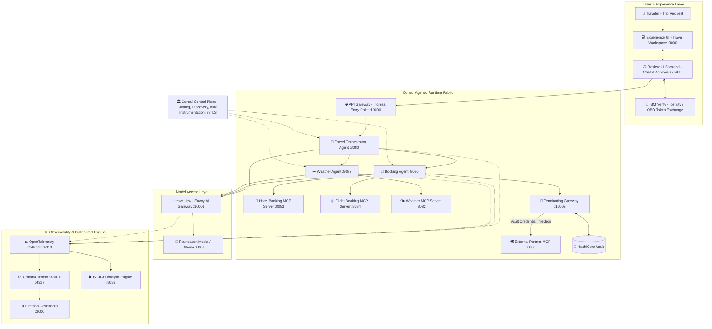
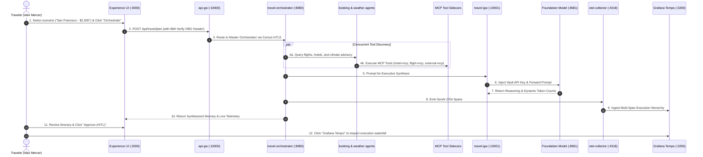

# 🧳 Consul Agentic Mesh Platform (CAMP) — Travel Booking Architecture

Production reference architecture and multi-agent implementation designed to showcase the full power of the **Consul Agentic Mesh Platform (CAMP)** and **Consul Enterprise 2.1 Service Mesh** on Red Hat OpenShift & Kubernetes.

[](https://developer.hashicorp.com/consul)
[](https://web-unified-docs-hashicorp.vercel.app/api/assets/consul/latest/img/architecture/camp-architecture.png)
[](https://opentelemetry.io/docs/specs/semconv/gen-ai/)
[](https://grafana.com/oss/tempo/)
[](LICENSE)

---

## 🏛️ Architecture Overview

This application implements the complete **CAMP Travel Booking Multi-Agent Ecosystem**:



---

## 🌟 Consul Agentic Mesh Platform (CAMP) Feature Capabilities

This reference architecture serves as a comprehensive showcase of **Consul Enterprise 2.1 for AI / Agentic Workloads**:

| Feature Capability | Where It Runs | Business & Technical Value |
| :--- | :--- | :--- |
| **🤖 Zero-Code Auto-Instrumentation** | Pod Annotations $\rightarrow$ Envoy + OTel | Automatically captures GenAI reasoning spans, token usage, and latency adhering to **OTel GenAI Semantic Conventions** without modifying Python agent source code. |
| **⚡ Envoy AI Gateway (`travel-igw`)** | Ingress/Egress Gateway (:10001) | Sub-millisecond token rate limiting (TPM/RPM protection), model failover, and prompt governance before touching LLM endpoints. |
| **🔑 Vault Credential Broker Injection** | `travel-igw` & `terminating-gw` | Zero-trust credential security. API keys (OpenAI, Anthropic, watsonx) and external partner GDS tokens are injected at the Envoy proxy layer—agents never store or see credentials. |
| **🔐 SPIFFE Identity & Zero-Trust Intentions** | Consul Service Mesh Data Plane | Cryptographic x509 mTLS identity per serviceaccount (`spiffe://cluster.local/ns/camp-travel/sa/booking-agent`). Granular L4/L7 intentions prevent unauthorized agents from accessing sensitive MCP tools. |
| **🛡️ Token Delegation & OBO Identity** | Ingress API Gateway (:10000) | Preserves user identity context (IBM Verify On-Behalf-Of tokens) across multi-agent delegation chains for auditing and compliance. |
| **📈 Distributed Tracing & Causal Observability** | OTel Collector (:4318) $\rightarrow$ Grafana Tempo (:3200) | End-to-end trace correlation across user requests, master orchestrator planning, concurrent sub-agents, MCP sidecars, and LLM inference. |
| **🚪 Secure Egress via Terminating Gateway** | Terminating Gateway (:10002) | Bridges internal mesh agents to external, non-meshed SaaS/GDS APIs (e.g. car rental or airline partner networks) with mTLS termination and credential injection. |
| **👤 Human-in-the-Loop (HITL) Governance** | Experience UI (:3000) + Review Backend | Enforces corporate travel compliance policies, manager authorization gates, and per-diem budget verification before issuing binding reservations. |

---

## 🎬 End-to-End Customer Demo Flow



---

## 🌐 Live OpenShift Endpoints

| Component | OpenShift Route URL | Description |
| :--- | :--- | :--- |
| **CAMP Experience UI** | 🔗 [https://camp-experience-ui-camp-travel.apps.rosa.cluster2.s5az.p3.openshiftapps.com](https://camp-experience-ui-camp-travel.apps.rosa.cluster2.s5az.p3.openshiftapps.com) | Interactive Traveler Workspace & HITL Review |
| **Grafana Tempo Traces** | 🔗 [https://camp-grafana-camp-travel.apps.rosa.cluster2.s5az.p3.openshiftapps.com/explore](https://camp-grafana-camp-travel.apps.rosa.cluster2.s5az.p3.openshiftapps.com/explore) | Distributed Tracing & Span Waterfall Inspection |
| **Ingress API Gateway** | 🔗 [https://camp-api-gw-camp-travel.apps.rosa.cluster2.s5az.p3.openshiftapps.com](https://camp-api-gw-camp-travel.apps.rosa.cluster2.s5az.p3.openshiftapps.com) | Mesh Ingress Entry Point |
| **Consul Enterprise UI** | 🔗 [https://consul-ui-consul.apps.rosa.cluster2.s5az.p3.openshiftapps.com](https://consul-ui-consul.apps.rosa.cluster2.s5az.p3.openshiftapps.com) | Service Mesh Topology, Catalog & mTLS Intentions |

---

## 🚀 Deployment with Helm (OpenShift & Kubernetes)

Deploy the entire CAMP Travel Booking Fabric with a single Helm command:

```bash
# 1. Create workload namespace and set SCC permissions (OpenShift)
oc create namespace camp-travel --dry-run=client -o yaml | oc apply -f -
oc adm policy add-scc-to-group consul-scc system:serviceaccounts:camp-travel
oc adm policy add-scc-to-group privileged system:serviceaccounts:camp-travel

# 2. Deploy the CAMP Travel Booking Helm Chart
helm upgrade --install camp-travel ./helm/camp-travel \
  --namespace camp-travel \
  --create-namespace
```

### Inspect Live Mesh Pods
```bash
oc get pods -n camp-travel
oc get routes -n camp-travel
```

---

## 🧪 Running Automated Tests

```bash
PYTHONPATH=. pytest tests/test_camp_travel.py -v
```

---

## 📁 Repository Structure

```
.
├── agents/                     # Multi-Agent Runtime Services
│   ├── orchestrator/           # Master Travel Orchestrator Agent
│   ├── booking_agent/          # Travel Booking Sub-Agent
│   └── weather_agent/          # Climate & Destination Sub-Agent
│
├── mcp_tools/                  # Model Context Protocol Tools
│   ├── hotel_booking/          # Hotel search & reservation MCP server
│   ├── flight_booking/         # Flight scheduling & ticket MCP server
│   ├── weather_server/         # Destination weather forecast MCP server
│   └── external_mcp/           # External Partner GDS tool
│
├── gateways/                   # Envoy Gateways
│   ├── api_gw/                 # Ingress API Gateway entry point (:10000)
│   ├── travel_igw/             # AI Gateway for Foundation Model Access (:10001)
│   └── terminating_gw/         # Terminating Gateway with Vault Credential Injection (:10002)
│
├── frontend/                   # Experience UI & Review Backend (:3000)
│   ├── main.py                 # FastAPI backend & IBM Verify OBO mock
│   └── static/index.html       # Modern TailwindCSS travel planner workspace
│
├── helm/camp-travel/           # Production Helm Chart (OpenShift / Kubernetes)
│   ├── Chart.yaml
│   ├── values.yaml
│   ├── files/index.html        # Packaged UI Single Page Application
│   └── templates/              # Deployments, Services, ConfigMaps, Tempo, Grafana, Routes
│
├── observability/              # AI Governance & Trace Ingestion
│   ├── otel/                   # OpenTelemetry Collector & Span Relay (GenAI Semantic Conventions)
│   └── indigo/                 # INDIGO Analytic Engine
│
├── llm_backend/                # Foundation Model Server with Dynamic Token Engine (:8081)
├── tests/test_camp_travel.py   # Automated pytest regression suite
├── docker-compose.yml          # Local container development definition
└── requirements.txt
```
