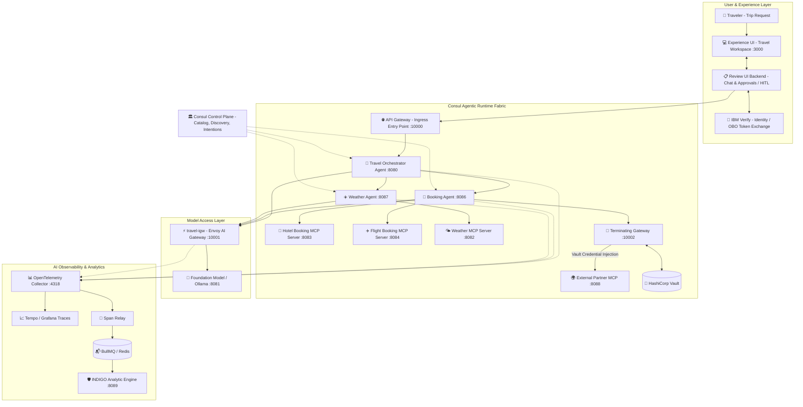

# 🧳 Consul Agentic Mesh Platform (CAMP) — Travel Booking Architecture

Reference architecture and multi-agent reference implementation for the **Consul Agentic Mesh Platform (CAMP)**, following HashiCorp's official Travel Booking blueprint.

[](https://developer.hashicorp.com/consul)
[](https://web-unified-docs-hashicorp.vercel.app/api/assets/consul/latest/img/architecture/camp-architecture.png)
[](LICENSE)

---

## 🏛️ Architecture Overview

This application implements the complete **CAMP Travel Booking Multi-Agent Ecosystem**:



---

## 🌟 Key Architecture Capabilities

1. **Experience UI & Review Backend (`:3000`)**:
   * Interactive travel planner with pre-set enterprise scenarios.
   * On-Behalf-Of (OBO) user token exchange via **IBM Verify**.
   * Human-in-the-Loop (HITL) manager approval flow for corporate travel booking.

2. **Multi-Agent Runtime Fabric (`:8080`, `:8086`, `:8087`)**:
   * **Travel Orchestrator Agent**: Master planner decomposing travel intent, invoking sub-agents concurrently, and generating executive summaries.
   * **Booking Agent**: Interacts with hotel and flight MCP servers.
   * **Weather Agent**: Ingests destination climate forecasts and provides clothing advisories.

3. **MCP Tool Ecosystem (`:8082`, `:8083`, `:8084`, `:8088`)**:
   * Model Context Protocol tools for hotel search/reservation, flight availability/ticketing, and weather conditions.
   * **External Travel Partner MCP** sitting outside the mesh, secured via the **Terminating Gateway** with Vault credential injection.

4. **`travel-igw` (Envoy AI Gateway `:10001`)**:
   * Sub-millisecond token rate limiting (TPM/RPM protection).
   * Proxy-layer Vault API key injection for LLM backends.
   * Dynamic multi-provider routing (OpenAI $\leftrightarrow$ Anthropic).

5. **AI Observability & INDIGO Engine (`:4318`, `:8089`)**:
   * OpenTelemetry trace collection and span relay across multi-agent boundaries.
   * INDIGO compliance audit engine verifying per-diem rules and token security.

---

## 🚀 Deployment with Helm (OpenShift & Kubernetes)

Deploy the entire CAMP Travel Booking Fabric with a single Helm command:

```bash
# 1. Create workload namespace and set SCC permissions (OpenShift)
oc create namespace camp-travel --dry-run=client -o yaml | oc apply -f -
oc adm policy add-scc-to-group consul-scc system:serviceaccounts:camp-travel
oc adm policy add-scc-to-group privileged system:serviceaccounts:camp-travel

# 2. Deploy the CAMP Travel Booking Helm Chart
helm upgrade --install camp-travel ./helm/camp-travel \
  --namespace camp-travel \
  --create-namespace
```

### Inspect Live Resources
```bash
oc get pods -n camp-travel
oc get routes -n camp-travel
```

---

## 🧪 Running Automated Tests

```bash
PYTHONPATH=. pytest tests/test_camp_travel.py -v
```

---

## 📁 Repository Structure

```
.
├── agents/                     # Multi-Agent Runtime Services
│   ├── orchestrator/           # Master Travel Orchestrator Agent
│   ├── booking_agent/          # Travel Booking Sub-Agent
│   └── weather_agent/          # Climate & Destination Sub-Agent
│
├── mcp_tools/                  # Model Context Protocol Tools
│   ├── hotel_booking/          # Hotel search & reservation MCP server
│   ├── flight_booking/         # Flight scheduling & ticket MCP server
│   ├── weather_server/         # Destination weather forecast MCP server
│   └── external_mcp/           # External Partner GDS tool
│
├── gateways/                   # Envoy Gateways
│   ├── api_gw/                 # Ingress API Gateway entry point (:10000)
│   ├── travel_igw/             # AI Gateway for Foundation Model Access (:10001)
│   └── terminating_gw/         # Terminating Gateway with Vault Credential Injection (:10002)
│
├── frontend/                   # Experience UI & Review Backend (:3000)
│   ├── main.py                 # FastAPI backend & IBM Verify OBO mock
│   └── static/index.html       # Modern TailwindCSS travel planner workspace
│
├── helm/camp-travel/           # Production Helm Chart (OpenShift / Kubernetes)
│   ├── Chart.yaml
│   ├── values.yaml
│   └── templates/              # ConfigMaps, ServiceAccounts, Deployments, Services, CRDs, Routes
│
├── observability/              # AI Governance & Trace Ingestion
│   ├── otel/                   # OpenTelemetry Collector & Span Relay
│   └── indigo/                 # INDIGO Analytic Engine
│
├── llm_backend/                # Foundation Model / Ollama mock (:8081)
├── tests/test_camp_travel.py   # Automated pytest regression suite
├── docker-compose.yml          # Local container development definition
└── requirements.txt
```
